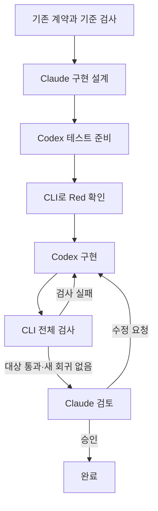

# SDD · BDD · TDD Harness

**명세에서 비즈니스 시나리오, 테스트, 구현, 검토까지 연결하는 개발 하네스입니다.**

Claude가 설계·검토하고 Codex가 코드를 구현합니다. 공통 검증 CLI가 테스트를 직접 실행하고, 어떤 요구사항을 어떤 검사로 확인했는지 실행 증거를 남깁니다. AI 없이 검증 CLI만 사용할 수도 있습니다.

> An SDD/BDD/TDD development harness with traceable specifications, automated verification, Claude design and review, and Codex implementation.

## 어떤 문제를 해결하나요?

AI가 코드를 작성한 뒤에도 확인해야 할 것이 있습니다. 원래 요구사항을 구현했는지, 테스트가 실제 비즈니스 동작을 검증하는지, 기존 기능을 깨뜨리지 않았는지입니다.

Harness는 세 가지 개발 방식을 연결해 이 확인 과정을 명시적으로 만듭니다.

| 계층 | 책임 | 주요 산출물 |
| --- | --- | --- |
| SDD — 명세 중심 개발 | 구현할 요구사항과 설계·범위를 정의 | `BRIEF.md`, `SPEC.md`, 요구사항 ID |
| BDD — 행위 중심 개발 | 관찰 가능한 비즈니스 동작을 구체화 | Given / When / Then 시나리오 |
| TDD — 테스트 주도 개발 | 실패 확인 → 최소 구현 → 통과·회귀 확인 | 테스트 코드와 실제 실행 기록 |

`harness.json`은 **요구사항 → 시나리오 → 검사 명령**을 연결하는 실행 가능한 계약입니다. 개발자와 AI 실행기가 같은 CLI와 JSON 결과를 사용합니다.

## 주요 기능

- 요구사항·시나리오·acceptance 검사 사이의 참조와 누락 검증
- 검사별 종료 코드, 출력, 실행 시간과 실패 원인 저장
- 입력 파일의 해시를 비교해 이전 결과가 오래되었는지 확인
- 자연어 요구사항으로 빈 Python 프로젝트의 명세·BDD·API 뼈대·테스트 생성
- Claude 설계 → Codex 테스트·구현 → CLI 검증 → Claude 검토 실행
- 수정 범위와 증거 변경 감지, 제한된 구현 재시도, 중단 사유 기록
- 같은 프로젝트에서 실행 기록을 쓰는 명령을 하나씩만 실행하는 운영체제 잠금
- CLI·로그인·프로젝트 환경을 확인하는 `doctor`와 Claude Code용 워크플로 스킬

## 준비 사항

| 사용 방식 | 필요한 환경 |
| --- | --- |
| `check`, `run`, `status` | Python 3.11 이상, 프로젝트 검사 명령에 필요한 도구 |
| `agent`의 `codex` 흐름 | 위 환경 + 설치·로그인된 Codex CLI |
| `init`, `agent`의 `claude-codex` 흐름 | 첫 행의 환경 + 설치·로그인된 Claude CLI와 Codex CLI |
| `init --implementer claude`, `agent`의 `claude` 흐름 | 첫 행의 환경 + 설치·로그인된 Claude CLI 2.1.248 이상 (Codex 불필요) |

Harness의 Python 런타임 의존성은 표준 라이브러리뿐입니다. AI 실행기는 설치된 CLI의 로그인과 모델 설정을 사용합니다. 실제 모델 호출은 해당 계정의 사용량을 소모합니다.

저장소를 내려받은 뒤 **저장소 루트에서** 아래 명령을 실행합니다.

```powershell
python --version
python -m harness --help
```

다른 디렉터리에서 쓰려면 Harness를 프로젝트와 **분리된 환경**에 설치합니다. 프로젝트의 가상환경에 설치하면 그 환경의 `.pth`·sitecustomize가 Harness 프로세스 안에서 실행되므로 권하지 않습니다. `doctor`의 `isolation` 항목이 이런 구성을 알려 줍니다.

```powershell
# 도구 전용 가상환경에 설치 (둘 중 하나)
pipx install .
uv tool install .
harness --help

# 또는 설치 없이 단일 파일로 실행 (Python 3.11 이상만 필요)
python -B tools/build_zipapp.py        # dist/harness.pyz를 만들고 SHA-256을 출력
python -I -S dist/harness.pyz --help
```

`harness.pyz`는 같은 소스에서 항상 같은 바이트로 만들어지므로, 다른 컴퓨터에 옮긴 파일을 SHA-256으로 대조할 수 있습니다.

프로젝트에 자체 가상환경이 있으면 `--python`으로 그 인터프리터를 지정합니다. 검사 명령의 `{python}`만 그 인터프리터로 실행되고, Harness와 검증기는 자기 인터프리터로 실행됩니다.

```powershell
harness --root PROJECT --python PROJECT/.venv/bin/python run     # Windows: PROJECT\.venv\Scripts\python.exe
```

## 빠른 시작: AI 없이 예제 검증하기

기본 검증 기능은 AI CLI나 로그인 없이 실행할 수 있습니다.

```powershell
python -B -m harness --root examples/inventory check
python -B -m harness --root examples/inventory run
python -B -m harness --root examples/inventory status
```

재고 예제는 재고 부족 예약 거절, 정상 예약, 재고가 정확히 소진되는 경계 조건을 검사합니다. 순서대로 계약의 `valid`, 실행의 `passed`, 현재 상태의 `passed`를 확인할 수 있습니다.

`inventory.py`를 변경하고 `status`를 다시 실행하면 이전 결과가 `stale`로 바뀝니다. `run`을 다시 실행하면 현재 파일에 대한 검증 기록을 만듭니다.

> `--root`는 항상 하위 명령 **앞에** 둡니다. 예: `harness --root PROJECT run`.

## 새 프로젝트: 자연어 요구사항에서 시작하기

### 1. 환경 확인

CLI를 설치하고 각 도구의 로그인 절차를 완료합니다.

```powershell
codex login
claude auth login
python -B -m harness doctor
```

`doctor`는 Python, CLI 경로·버전·로그인 상태, 프로젝트 접근 가능 여부, 존재하는 계약과 증거 무결성 표시를 확인합니다. 기존 `harness.json`이 없어도 사용할 수 있습니다. 모델 호출이나 잔여 사용량 확인은 수행하지 않습니다.

Codex만 사용할 때는 `doctor --provider codex`, Claude만 확인할 때는 `doctor --provider claude`를 사용합니다.

### 2. 요구사항 작성 및 초기화

UTF-8 텍스트 파일에 원하는 기능, 구체적인 입력·출력 예, 오류 처리 또는 호출자 사전조건, 제외 범위를 작성합니다. [예제 요구사항](examples/new_project_brief.md)을 참고할 수 있습니다.

```powershell
python -B -m harness --root ../NewProject init --brief examples/new_project_brief.md
```

`--brief`의 상대 경로는 명령을 실행한 디렉터리 기준입니다. 대상 프로젝트는 아직 없거나, 원본 요구 파일 하나와 `.harness` 이력을 제외하고 비어 있어야 합니다. 가상환경이나 Git 저장소를 만들기 전의 빈 대상 폴더를 사용합니다.

초기화는 다음 순서로 진행합니다.

1. Claude가 요구사항·설계·Given/When/Then을 구조화합니다.
2. Harness가 `BRIEF.md`, `SPEC.md`, `harness.json`과 시나리오별 검사 명령을 만듭니다.
3. Codex(또는 `--implementer claude`이면 Claude)가 `src/`에 미구현 API 뼈대, `tests/`에 실제 기대 결과를 단정하는 unittest 테스트를 작성합니다.
4. 공통 CLI가 초안을 검사하고, 모든 시나리오의 테스트가 `src/`의 `NotImplementedError` 때문에 실패하는지 확인합니다.
5. 조건을 충족한 파일을 대상에 배치하고 `ready`를 반환합니다.

**`ready`는 구현 준비 완료입니다. 이 시점의 테스트는 의도적으로 실패합니다.** 빈 테스트, import 오류, 테스트 본문의 인위적인 실패, 이미 통과하는 구현은 유효한 초기 Red로 인정하지 않습니다.

생성되는 프로젝트 구조는 다음과 같습니다.

```text
NewProject/
├── BRIEF.md        # 원본 요구사항 사본
├── SPEC.md         # 설계·요구사항·비즈니스 시나리오
├── harness.json    # 추적 관계·검사 명령·AI 수정 범위
├── src/            # 미구현 API 뼈대
├── tests/          # 시나리오별 테스트
├── .gitignore      # .harness·캐시 제외 (추적 입력 아님)
└── .harness/       # 초안·실행 기록·AI 응답과 로그
```

### 3. 명세 확인 후 구현 실행

생성된 명세와 시나리오가 원래 요구를 반영했는지 확인한 뒤 실행합니다.

```powershell
python -B -m harness --root ../NewProject agent
python -B -m harness --root ../NewProject status
```

`init`은 구현을 자동 시작하지 않습니다. 응답의 `next_command`는 첫 요구사항을 명시적으로 선택하는 실행 명령입니다. 요구사항이 여러 개라면 `agent --requirement ID`로 하나씩 처리합니다.

질문이 반환되면 `question`, `message`, `draft`를 확인하고 요구사항을 보완합니다. 이미 초기화된 프로젝트에는 `init`을 다시 적용하지 않고 기존 계약을 검토한 뒤 `agent`를 사용합니다.

## 기존 프로젝트에서 사용하기

기존 테스트 명령과 요구사항을 `harness.json`에 연결합니다. 다음은 [재고 예제 계약](examples/inventory/harness.json)을 단순화한 예입니다.

```json
{
  "version": 1,
  "inputs": ["inventory.py", "test_inventory.py"],
  "agent": {
    "workflow": "claude-codex",
    "code_paths": ["inventory.py"],
    "test_paths": ["test_inventory.py"]
  },
  "requirements": [
    {"id": "REQ-STOCK", "description": "재고가 부족하면 예약을 거절하고 기존 재고를 유지한다."}
  ],
  "scenarios": [
    {
      "id": "SCN-REJECT",
      "requirement": "REQ-STOCK",
      "given": "재고가 2개다",
      "when": "3개를 예약한다",
      "then": "예약을 거절하고 재고 2개를 유지한다"
    }
  ],
  "checks": [
    {
      "id": "CHK-REJECT",
      "kind": "acceptance",
      "scenarios": ["SCN-REJECT"],
      "command": ["{python}", "-B", "-m", "unittest", "test_inventory.InventoryTests.test_rejects_insufficient_stock"],
      "timeout_seconds": 30
    }
  ]
}
```

계약의 주요 규칙은 다음과 같습니다.

- ID는 계약 전체에서 고유해야 합니다. 모든 요구사항에 시나리오, 모든 시나리오에 acceptance 검사가 필요합니다.
- 하나의 검사에 여러 시나리오를 연결할 수 있습니다. `unit` 검사는 필요한 경우 추가합니다.
- 입력 경로는 프로젝트 내부의 기존 파일·디렉터리여야 합니다. `harness.json` 자체는 항상 추적합니다.
- 명령은 프로젝트 루트에서 실행하는 인자 배열입니다. `{python}`은 `--python`으로 지정한 인터프리터, 지정하지 않으면 Harness를 실행한 Python으로 치환합니다. 셸 문법은 해석하지 않습니다.
- Python이 아닌 프로젝트는 `["npm", "test"]`, `["go", "test", "./..."]`처럼 도구를 직접 적습니다. `{python}` 외의 자리표시자는 없습니다.
- 검사 명령의 종료 코드 0을 통과로 처리합니다. 명령이 실제 assertion을 실행하도록 구성해야 합니다.
- 검증 CLI만 사용할 때는 `agent` 설정을 생략할 수 있습니다.

AI를 사용하려면 `code_paths`와 `test_paths`를 지정합니다. 두 범위는 서로 겹치지 않는 기존 경로이며 `inputs`가 추적하는 범위 안에 있어야 합니다.

```powershell
python -B -m harness --root examples/inventory agent --requirement REQ-STOCK --max-attempts 3 --timeout-seconds 300
```

`workflow`는 다음 셋 중 하나입니다. 생략하면 Codex 단독 흐름을 사용합니다.

| `workflow` | 설계·검토 | 테스트·구현 |
| --- | --- | --- |
| `codex` | 없음 | Codex |
| `claude-codex` | Claude | Codex |
| `claude` | Claude | Claude |

`init --implementer claude`로 만든 프로젝트는 처음부터 `claude` 흐름을 씁니다.

## AI 역할과 완료 조건



위 그림은 실패한 요구사항을 처리하는 `claude-codex` 흐름입니다. `claude` 흐름은 Codex 단계를 Claude가 맡고 나머지는 같습니다. 구현·검토 재작업은 `--max-attempts` 한도 안에서 수행합니다. `--timeout-seconds`는 AI 호출별 제한이며 기본값은 300초입니다.

| 역할 | 수행 작업 | 수정 범위 |
| --- | --- | --- |
| Claude 설계 | 기존 명세와 코드에서 구현 계획·테스트 전략 작성 | 읽기 전용 |
| 구현자 테스트 (Codex 또는 Claude) | 기존 실패 테스트를 검토하거나 새 테스트 파일 추가 | `test_paths`에 새 파일만 추가 |
| 구현자 구현 (Codex 또는 Claude) | 선택한 요구사항 구현 및 발생한 회귀 수정 | `code_paths` |
| 검증 CLI | 실제 검사 실행 및 상태 계산 | 실행 증거 저장 |
| Claude 검토 | 명세·코드·테스트·diff·검사 증거 검토 | 읽기 전용 |

이미 충분한 실패 테스트가 있으면 새 테스트 추가를 강제하지 않습니다. 설계와 검토는 별도 세션에서 실행합니다. 명세나 기존 테스트를 수정해야 하면 `needs_input`으로 중단합니다.

자동 선택은 계약 순서의 첫 미통과 요구사항입니다. 이미 모든 검사가 통과한 프로젝트를 Claude로 검토하려면 `--requirement ID`를 지정합니다. 이 경우 설계·검토를 거쳐 승인되면 코드 수정 없이 완료할 수 있습니다.

### Claude가 구현을 맡을 때

Claude 구현자는 `--restricted` 모드에서 Read·Glob·Grep·Edit·Write 도구만 받습니다. Bash 같은 명령 실행 도구와 WebFetch가 없고, 편집은 그 단계의 경로(`Edit(./src/**)` 같은 규칙)로 제한됩니다. 그래서 OS sandbox가 없는 native Windows에서도 명령이 실행되지 않습니다. 대신 Claude는 테스트를 직접 돌리지 못하고, Harness가 실행한 결과를 다음 시도에서 받습니다. 도구 제한은 1차 방어이고, Codex와 같은 변경 감지·증거 보호가 최종 판정입니다.

같은 모델 계열이 구현과 검토를 모두 맡으면 같은 오해를 공유하기 쉽습니다. 검토 모델을 다르게 지정하는 것을 권합니다.

```powershell
python -B -m harness --root PROJECT agent --requirement ID --review-model opus --implement-model sonnet
```

`--review-model`은 Claude의 명세·설계·검토, `--implement-model`은 Claude의 테스트·구현에 쓰입니다. 모델 옵션은 계약이 아니라서 `harness.json`이 아닌 실행 기록(`run.json`의 `models`)에 남고, 바꿔도 기존 검사 결과가 stale이 되지 않습니다.

Codex 단독 흐름은 Claude 단계를 생략하며, 이미 통과한 대상은 AI 호출 없이 종료합니다. 구현 후 완료 판정은 이번 실행에서 새로 얻은 검사 결과를 사용합니다. 선택한 요구사항의 통과와 기존 통과 검사의 회귀 해소가 필요하며, Claude 흐름에는 검토 승인도 필요합니다.

## 명령 모음

아래 명령의 `PROJECT`, `ID`, `FILE`, `PYTHON`은 실제 경로·ID로 바꿉니다. `--root`를 생략하면 현재 디렉터리를 대상으로 합니다. `python -m harness` 대신 설치한 `harness` 명령이나 `python -I -S dist/harness.pyz`를 써도 같습니다. `--root`와 `--python`은 명령 이름 앞에 둡니다.

| 명령 | 역할 |
| --- | --- |
| `python -m harness --root PROJECT doctor` | 로컬 CLI·로그인·프로젝트 사전 점검 |
| `python -m harness --root PROJECT check` | 계약 형식·참조·입력 경로 검증 |
| `python -m harness --root PROJECT run` | 전체 검사 실행·증거 저장 |
| `python -m harness --root PROJECT run --requirement ID` | 요구사항 하나에 연결된 검사 실행 |
| `python -m harness --root PROJECT --python PYTHON run` | 검사의 `{python}`을 프로젝트 인터프리터로 실행 (agent·init·doctor도 같은 옵션) |
| `python -m harness --root PROJECT status` | 현재 입력과 저장된 검사 결과 비교 |
| `python -m harness --root PROJECT init --brief FILE` | 빈 프로젝트의 명세·테스트 뼈대 생성 |
| `python -m harness --root PROJECT init --brief FILE --implementer claude` | Claude만으로 뼈대 생성, `claude` 흐름 계약 생성 |
| `python -m harness --root PROJECT agent --requirement ID` | 요구사항 하나의 구현·검증·검토 |

## 결과 읽기

CLI는 JSON 객체를 출력합니다. 검사 프로그램의 출력은 결과의 `stdout`, `stderr`에 들어갑니다.

| 상태 | 의미 | 종료 코드 |
| --- | --- | --- |
| `valid` | 계약 구조와 입력 경로가 유효함 | 0 |
| `ready` | `init`의 구현 준비 완료 또는 `doctor`의 사전 점검 통과 | 0 |
| `passed` | 대상 검사 또는 개발 작업의 완료 조건 충족 | 0 |
| `failed` | 검사 실패 또는 구현·검토 시도 종료 | 1 |
| `stale` | 입력이 바뀌어 기존 검증 결과를 재사용할 수 없음 | 1 |
| `unverified` | 실행 기록이 없는 검사가 있음 | 1 |
| `needs_input` | 질문·환경 문제·범위 위반 등으로 확인이 필요함 | 1 |
| `error` | 계약·기록·파일 접근·AI 호출 등의 오류 | 2 |

`agent` 결과에서는 다음 세 필드를 함께 확인합니다.

- `status`: 선택한 개발 작업의 결과
- `project_status`: 전체 프로젝트의 최근 검사 상태
- `review_status`: Claude의 `approved`, `changes_requested`, `needs_input`, 아직 검토하지 않은 `unverified`, Codex 단독 흐름의 `not_requested`

이전에 실패했던 다른 요구사항이 남아 있어도 선택한 작업은 완료할 수 있습니다. `status` 명령은 저장된 테스트 결과를 조회하며 Claude의 검토 승인까지 합산하지 않습니다. 승인은 해당 `agent` 기록의 `review_fingerprint`와 일치하는 파일 상태에 적용됩니다.

## 실행 증거와 변경 감지

프로젝트별 `.harness/`에 증거를 보존합니다.

```text
.harness/
├── runs/                         # 검증 실행별 JSON 기록
├── init-runs/<session-id>/        # 초기화 기록·초안·AI 호출 자료
├── agent-runs/<session-id>/       # 개발 실행 기록
│   ├── run.json
│   ├── design/
│   ├── tests/
│   ├── implement-1/
│   └── review-1/                  # 검토 응답·changes.diff
├── incidents/                    # 증거 변경 감지 시 보존한 호출 자료
├── integrity-violation.json       # 증거 변경 감지 시 생성되는 표시
├── lock                          # run·agent·init의 운영체제 잠금 파일
└── lock-owner.json               # 잠금 보유 명령·PID·시작 시각
```

AI 호출 자료에는 프롬프트, 응답 스키마, 응답 JSON, 표준 출력·오류 로그가 포함됩니다. 응답 형식을 보정했다면 단계 폴더의 `repair/`에 보정 자료도 저장합니다.

두 종류의 변경 확인을 구분합니다.

- **검증 결과의 유효성:** 계약과 `inputs`의 경로·내용을 해시합니다. 입력이 바뀌면 기존 결과 전체를 보수적으로 `stale`로 처리합니다. 입력에는 테스트 설정·의존성 잠금 파일 등 결과에 영향을 주는 파일도 포함해야 합니다.
- **AI 수정 범위:** 호출 전후에 추적 입력 밖의 파일도 비교합니다. 허용 경로 안이라도 `__pycache__`, `.venv` 같은 캐시·환경 폴더의 변경은 거부합니다. Python은 `-B`에서도 캐시된 bytecode를 읽기 때문입니다. 반면 IDE의 `git status`가 바꾸는 `.git/index` 같은 `.git` 내부 파일(hooks·config·info/attributes 제외), `.pytest_cache` 같은 데이터 캐시, `.DS_Store`·`Thumbs.db`·`desktop.ini`는 멈추지 않고 단계 기록의 `ignored_changes`로만 보고합니다. 증거 폴더는 별도로 검사하며, 기존 증거 변경이 감지되면 이력을 신뢰하지 않도록 표시하고 중단합니다.

검증 입력을 순회할 때는 `.git`, `.harness`, `.venv`, `__pycache__`, `.pytest_cache`를 제외합니다. AI 수정 범위를 검사하는 전체 프로젝트 비교는 이 검증 입력 해시와 별개입니다.

변경 감지는 크기·수정 시각이 그대로인 오래된 파일의 해시를 재사용하므로, 큰 `.venv`나 `.git`이 있어도 실행 중 첫 비교 이후에는 빠릅니다. Windows에서는 내용을 바꾼 뒤 크기와 수정 시각까지 되돌린 파일을 놓칠 수 있습니다(POSIX는 ctime으로 감지합니다).

`agent`와 `init`이 호출하는 검증 CLI는 `python -I -S`로 실행됩니다. 프로젝트의 `harness.py`·`sitecustomize.py`·PYTHONPATH와, Harness를 실행한 환경의 `.pth` 파일이 검증기를 바꾸지 못합니다. 실행 기록의 `interpreters`에 Harness와 검사의 인터프리터가 남습니다.

변경 감지는 호출 전후 비교이며 OS 보안 격리나 암호학적 증거 인증을 제공하지 않습니다. 실행 도중 변경 후 복원된 내용을 모두 탐지하지는 못합니다. 검사 명령은 프로젝트 코드를 실행하므로 신뢰할 수 있는 프로젝트에서 사용합니다.

`run`, `agent`, `init`은 증거를 쓰기 전에 `.harness/lock`을 잠급니다. 같은 프로젝트에서 두 번째 명령은 기다리지 않고 아무것도 쓰지 않은 채 `project_locked`로 끝나므로, 동시 실행이 서로의 기록을 증거 변경으로 오인하지 않습니다. 잠금은 보유 프로세스가 끝나면(강제 종료 포함) 운영체제가 해제하므로 잠금 파일을 지울 필요가 없습니다. `check`, `status`, `doctor`는 잠그지 않습니다.

## 중단 원인과 대응

`reason`, `message`, `question`과 연결된 기록을 먼저 확인합니다.

| `reason` | 확인할 내용 |
| --- | --- |
| `agent_question` | 질문에 답하고 명세의 모호한 부분 정리 |
| `red_not_observed`, `scaffold_not_red` | 기대·관측 Red ID, 검사별 `stub_red_problems`, `check_diagnostics`, `verification_record` 확인 |
| `scope_changed`, `contract_changed` | `changed_files`와 실제 diff 검토 |
| `review_scope` | 검토가 요구한 명세·테스트·보호 파일 변경을 사람이 결정 |
| `inputs_changed`, `brief_changed`, `project_changed` | 실행 중 다른 편집이 있었는지 확인한 뒤 다시 실행 |
| `evidence_changed` | 무결성 표시·변경된 증거·incident 로그 확인 및 손상 기록 복구·격리 |
| `verification_setup` | 검사 도구·의존성·실행 오류·시간 초과 해결 |
| `invalid_response` | 원본 응답과 `repair/` 확인 |
| `agent_missing`, `agent_launch` | CLI 설치·실행 권한·로그인 확인(`agent_missing`은 `missing`에 목록이 있음). `doctor`로 다시 점검 |
| `agent_outdated` | Claude 구현에 필요한 Claude Code 2.1.248 이상으로 업데이트 (`version`, `minimum` 확인) |
| `agent_exit`, `agent_timeout`, `verification_error` | 호출 로그·검증 기록과 필요 시 `doctor` 확인 |
| `project_locked` | `lock_owner`의 명령이 끝날 때까지 기다림. 잠금 파일은 지우지 않음 |
| `requirement_required` | 검토할 요구사항을 `--requirement`로 지정 |
| `input_error` | `message`의 경로·형식·권한 문제 해결 |
| `interrupted` | 저장된 단계와 현재 변경을 검토한 뒤 새 실행 시작 |
| `no_progress`, `attempt_limit`, `review_rejected` | 남은 실패 검사 또는 검토 지적 해결 |

잘못된 구조화 응답은 원래 작업을 반복하지 않는 읽기 전용 형식 보정을 한 번 시도합니다. 인증 오류·실행 실패·시간 초과는 같은 방식으로 자동 재호출하지 않습니다.

SIGINT·처리 가능한 SIGTERM 또는 시간 초과 시 자식 프로세스 트리 정리를 시도합니다. POSIX는 SIGTERM을 보내고 3초 뒤 SIGKILL을 보내며, Windows는 `taskkill /T /F`로 바로 종료합니다. `agent`, `init`, 검사 실행은 처리 가능한 중단을 기록합니다. SIGKILL이나 Windows의 강제 프로세스 종료처럼 처리할 수 없는 종료에서는 기록을 보장할 수 없고, SIGHUP은 처리하지 않습니다.

`agent`와 `init`은 시작할 때 workflow에 필요한 CLI가 PATH에 있는지 먼저 확인합니다. 없으면 기준 검사나 모델 호출 전에 `agent_missing`으로 끝납니다.

중단 시 소스를 자동으로 되돌리지 않습니다. 세션 재개 기능은 없으며 다시 실행하면 현재 파일을 새로 검증합니다. 증거 변경이 감지됐다면 영향받은 기록을 검토·복구 또는 격리한 뒤 무결성 표시를 제거하고 재검증해야 합니다.

## Claude Code 스킬

[harness-workflow 스킬](.claude/skills/harness-workflow/SKILL.md)은 brief 작성, CLI 실행, 결과와 중단 원인 해석을 안내합니다. 이 저장소를 연 Claude Code 세션에서 다음과 같이 사용할 수 있습니다.

```text
/harness-workflow
```

새 프로젝트의 `init` 대상은 비어 있어야 하므로 스킬 파일은 Harness 저장소에 둡니다.

## 데모와 개발 검증

실제 모델을 사용하는 데모는 별도 복사본을 만들며 원본 예제를 보존합니다.

```powershell
# 자연어 요구사항 → 새 프로젝트 → 구현 → 검토
python -B examples/run_init_demo.py

# 재고 예제에 버그 주입 → 설계 → 수정 → 검증 → 검토
python -B examples/run_agent_demo.py

# 같은 데모를 Claude만으로 실행 (Codex 불필요)
python -B examples/run_init_demo.py --implementer claude
python -B examples/run_agent_demo.py --implementer claude
```

결과 프로젝트는 `.harness/demos/` 아래에 생성됩니다. 두 데모 모두 실제 AI 사용량을 소모합니다.

기본 테스트는 AI 응답을 대체하며 외부 모델을 호출하지 않습니다.

```powershell
python -B -m unittest discover -s tests -v
python -B -m harness check
python -B -m harness run
python -B -m harness status
```

타입 검사는 개발할 때만 합니다. Harness 실행에는 필요 없으며, `harness`와 `tools`는 mypy `--strict`를 Linux·Windows·macOS 분기 모두에서 통과합니다.

```powershell
uv run --only-group dev mypy                               # pyproject.toml에 고정한 mypy 사용
python -m pip install mypy==2.3.1; python -m mypy          # uv가 없을 때
python -m mypy --platform win32                            # 다른 OS 분기도 확인
```

GitHub Actions(`.github/workflows/ci.yml`)가 push마다 Ubuntu·Windows·macOS와 Python 3.11·3.13에서 테스트와 자기 계약 실행을, Ubuntu에서 타입 검사를 실행합니다.

테스트 모음은 CLI, AI 실행기, 역할 분리, 초기화, 변경 감지·증거 보호, 잠금, 실행 환경 분리와 단일 파일 배포를 다룹니다. 모든 테스트가 `harness.json`의 검사에 연결되어 있는지도 테스트로 확인합니다. 하네스 자체의 요구사항과 검사 연결은 [harness.json](harness.json), 상세 설계는 [SPEC.md](SPEC.md)를 참고하세요.

## 현재 범위

자연어 초기화는 Python 3.11 이상·표준 라이브러리·unittest 프로젝트를 대상으로 합니다. 기존 프로젝트의 검증은 등록된 명령을 실행하며 필요한 도구와 의존성은 사용자가 준비합니다.

한 번의 AI 개발 실행은 요구사항 하나를 처리합니다. 같은 프로젝트에서는 잠금으로 `run`·`agent`·`init`을 한 번에 하나만 실행하며, 대기열·병렬 개발·세션 재개는 지원하지 않습니다. 명세 근거의 구조화된 표시와 별도 독립 QA 단계도 향후 검토 대상입니다.

테스트 통과와 Claude 승인은 검증 근거입니다. 생성된 명세의 업무적 가정과 테스트가 실제 사용자 의도를 충분히 반영하는지는 사람이 함께 확인해야 합니다.

## 라이선스

이 프로젝트는 [MIT License](LICENSE)를 따릅니다.
